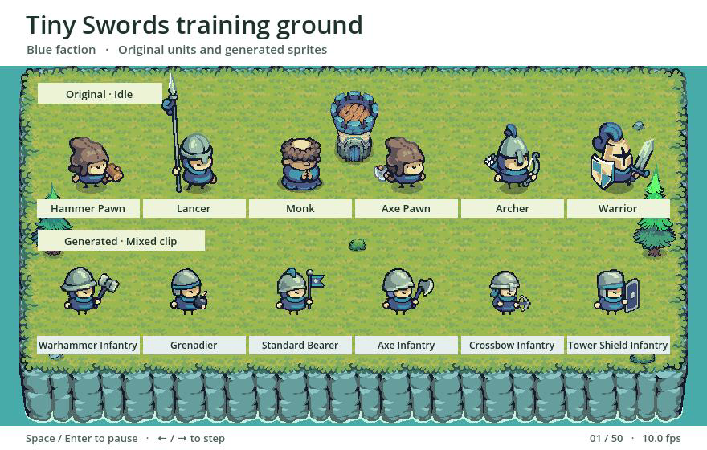
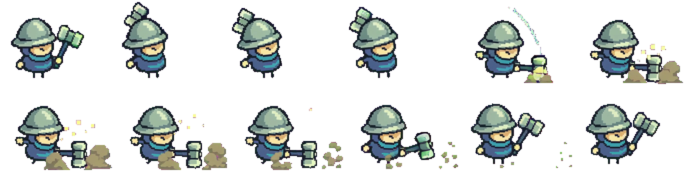
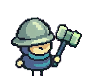
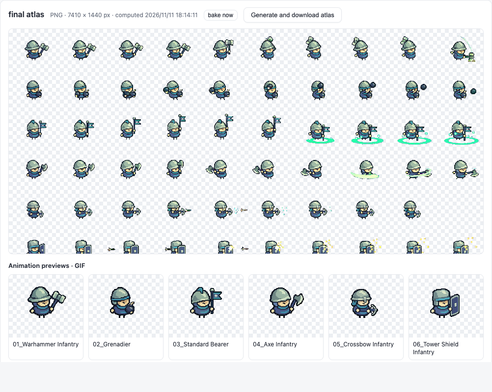

# Pixel Asset Workshop

[Start SpriteFrame](#use-the-spriteframe-workbench) · [Install the CLI](#install) · [简体中文](README.zh.md) · [Tiny Swords case study](examples/tiny-swords/README.md) · [Live showcase](https://daetz-coder.github.io/projects/pixel-asset-workshop/) · [Contributing](CONTRIBUTING.md)

Extract reusable art direction from a reference game, create original characters and scenery, and animate several characters in a single video. Export each character as a separate transparent PNG sequence. The workflow is intended for indie teams expanding a roster, testing an art direction, or producing repeated animation batches.

This repository includes the **SpriteFrame** browser workbench and a command-line extractor. Start the workbench locally to crop and key the footage, choose frames, and export PNGs, sprite sheets and GIFs.

[](https://daetz-coder.github.io/projects/pixel-asset-workshop/showcase/godot.html)

The five-second Godot 4.5.1 recording shows the original Tiny Swords units idling above the six generated units. Tiny Swords art by [Pixel Frog](https://pixelfrog-assets.itch.io/tiny-swords). [Play the recording](https://daetz-coder.github.io/projects/pixel-asset-workshop/showcase/godot.html) · [MP4 file](examples/tiny-swords/preview/training-ground.mp4) · [Run the Godot comparison](examples/tiny-swords/README.md#compare-the-original-in-godot)

[Watch the 21.5-second workflow walkthrough](https://daetz-coder.github.io/projects/pixel-asset-workshop/showcase/godot.html#workflow-video)

| Stage | Workflow | Output |
| --- | --- | --- |
| 1. Learn the style | Record camera angle, body proportions, pixel scale and material colors. Calibrate one sprite, then apply the rules to characters, buildings, terrain and UI. | Style profile, side-by-side comparison and an approved sample |
| 2. Generate and compose | Create a transparent PNG for each character. Pack compatible sprites into a shared first frame with a common foot baseline and a motion prompt for each cell. | First-frame PNG, per-cell prompts and layout JSON |
| 3. Generate video and extract frames | Submit one clip per batch, using Wan3.0 Video Prime as an example. Map the layout to the actual video size, sample frames, key out the background and review the results. | RGBA PNG sequences with sampling and edge-contact metadata |

The included example uses **six units and one five-second Wan clip**. SpriteFrame preserves 900 candidate frames at the video's original frame rate. The 10 fps command-line example samples 300. At the same duration and resolution, batching takes one submission for the six units. Pricing and retries determine the actual cost. Start with idle or walk cycles. Wide swings, projectiles and large effects may need more space per character.

## Exported sprites

The Warhammer Infantry sprite sheet and GIF use the same 12 frames. Read the sheet from left to right, then top to bottom. The GIF displays each frame for 200 ms.

[](examples/tiny-swords/preview/exports/warhammer-sheet.png)



[All six PNG sheets and GIFs](https://daetz-coder.github.io/projects/pixel-asset-workshop/showcase/spriteframe.html#exports) · [Frame coordinates, anchors and durations](examples/tiny-swords/preview/exports/manifest.json)

## Install

1. Clone with Git, or download and unpack the ZIP and open a terminal in the extracted folder. Run the commands below from the folder containing `requirements.txt`. [Download ZIP](https://github.com/daetz-coder/pixel-asset-workshop/archive/refs/heads/main.zip)

   ```sh
   git clone https://github.com/daetz-coder/pixel-asset-workshop.git
   cd pixel-asset-workshop
   ```

2. Install Python 3.10 or newer and FFmpeg. Use `python3 --version` on macOS and Linux or `py -3 --version` on Windows to check Python. Both `ffmpeg -version` and `ffprobe -version` should work in your terminal. [Python downloads](https://www.python.org/downloads/) · [FFmpeg downloads](https://ffmpeg.org/download.html)

   | Platform | Install FFmpeg and Python support |
   | --- | --- |
   | macOS with Homebrew | `brew install ffmpeg`. Use the Python installer if `python3` is missing or older than 3.10. |
   | Ubuntu or Debian | `sudo apt install python3 python3-venv ffmpeg`. Check the installed Python version. |
   | Windows with WinGet | `winget install --id Gyan.FFmpeg --exact`. Install Python with the launcher, then open a new PowerShell window. |

3. Create a Python environment and install the project dependencies for your platform.

   **macOS or Linux**

   ```sh
   python3 -m venv .venv
   . .venv/bin/activate
   python -m pip install -r requirements.txt
   ```

   **Windows PowerShell**

   ```powershell
   py -3 -m venv .venv
   .\.venv\Scripts\python.exe -m pip install -r requirements.txt
   ```

Install ImageMagick 7 (`magick`) if you want to compose a new first frame or validate a Wan request. The included extraction example needs only the dependencies above. [ImageMagick downloads](https://imagemagick.org/script/download.php)

## Reproduce the example offline

Run the first extraction with the included MP4 and its crop layout. It runs locally without an API key.

```sh
python scripts/extract_frames.py \
  --video assets/video-inputs/blue-units-3x2-wan-prime-480p.mp4 \
  --layout examples/tiny-swords/wan-layout.json \
  --fps 10 --despill-magenta --out work/tiny-swords/frames
```

On Windows PowerShell, use the virtual environment's Python directly.

```powershell
.\.venv\Scripts\python.exe scripts/extract_frames.py --video assets/video-inputs/blue-units-3x2-wan-prime-480p.mp4 --layout examples/tiny-swords/wan-layout.json --fps 10 --despill-magenta --out work/tiny-swords/frames
```

A successful run reports **6 cells × 50 frames**. Open `work/tiny-swords/frames/r01c01/attack/0000.png` to inspect the first transparent frame, and read `work/tiny-swords/frames/manifest.json` for the crop, foot anchor and flagged frames. Pick a new `--out` directory for a repeat run. Review each sequence and split the mixed clip by action before using it in a game.

To reproduce the example sprite sheets and GIFs, run `python examples/tiny-swords/export_previews.py --frames work/tiny-swords/frames --out work/tiny-swords/exports`. In PowerShell, replace `python` with `.\.venv\Scripts\python.exe`.

## Use the SpriteFrame workbench

On macOS or Linux, clone or unzip this repository and install Python 3.11 or newer plus FFmpeg and ffprobe. Run these commands from the repository root. [Workbench guide](workbench/README.md)

```sh
./workbench/setup.sh
./workbench/start.sh
```

Open `http://127.0.0.1:8766`. English is the default, and the language menu also offers 中文. Choose **Import crop layout** and open the matching MP4. Set the key color to **Magenta** and click **Extract every frame and choose**. In **Curate**, review the suggested sequence and save the PNGs, atlas or GIF. [Sample layout](examples/tiny-swords/wan-layout.json) · [Sample MP4](assets/video-inputs/blue-units-3x2-wan-prime-480p.mp4) · [Workbench walkthrough](https://daetz-coder.github.io/projects/pixel-asset-workshop/showcase/spriteframe.html)

[](workbench/README.md)

## Install the agent skills

Copy the complete skill directories you need from `skills/` into your client's skills folder. For Codex in this repository, use `.agents/skills/` under the repository root. Open the project in Codex and invoke `$reference-game-characters` for art direction, `$wan-prime-video` for batch composition, or `$spriteframe` for reviewed Godot exports. [Codex skill discovery](https://learn.chatgpt.com/docs/build-skills#where-codex-loads-local-skills)

## Create a batch with your own sprites

1. Build a style profile and compare one new sprite with a reference at the same body scale. Once the sample is approved, generate the remaining transparent PNGs. GPT Image or another image generator with reference-image support can handle this step. [Reference art skill](skills/reference-game-characters/SKILL.en.md) · [Tiny Swords comparison](examples/tiny-swords/README.md#comparison-with-the-original)
2. Copy the sample config and change the paths, names and motions. Image paths are relative to the config file. Characters fill the grid left to right, then top to bottom. [Walk batch config](examples/tiny-swords/batch-walk.json)

   ```sh
   python skills/wan-prime-video/scripts/compose_reference.py \
     --config examples/tiny-swords/batch-walk.json \
     --output work/tiny-swords/walk.png
   ```

   This produces `walk.png`, `walk-prompt.txt` and `walk-layout.json` for a new walk batch.
3. Submit the first frame and prompt in a video model's interface or use the Wan runner. After generation, pair the new MP4 with its own layout JSON for command-line extraction or visual review in SpriteFrame. [Wan skill](skills/wan-prime-video/SKILL.md) · [Integrations and layout format](docs/integrations.en.md) · [SpriteFrame guide](workbench/README.md)

## Resources

| Resource | Use |
| --- | --- |
| [Live showcase](https://daetz-coder.github.io/projects/pixel-asset-workshop/) | Open `index.html` from a local checkout to browse the workflow, SpriteFrame captures and Godot playback |
| [Tiny Swords case study](examples/tiny-swords/README.md) | Get the tested clip and layout, and reproduce the original-versus-generated review |
| [Reference art skill](skills/reference-game-characters/SKILL.en.md) | Reuse art direction, prompts and reference-frame comparison tools |
| [Wan batch skill](skills/wan-prime-video/SKILL.md) | Compose the first frame, prompt and layout, with optional Wan submission |
| [Frame extraction CLI](scripts/extract_frames.py) | Reproduce the export locally without a model account |
| [Integration guide](docs/integrations.en.md) | Use SpriteFrame, swap video providers or automate the workflow |

## Contributing

Bug reports and pull requests are welcome. For a cropping or frame extraction issue, include the command, the layout JSON and the affected frame numbers. [Open an issue](https://github.com/daetz-coder/pixel-asset-workshop/issues/new/choose) · [Contributing guide](CONTRIBUTING.md) · [Offline workflow checks](https://github.com/daetz-coder/pixel-asset-workshop/actions/workflows/ci.yml)

## License

- **Project code and documentation** use the MIT License. Commercial use is allowed. Keep the copyright and permission notices with copies or substantial portions. Bundled third-party components retain their own licenses. [MIT License](LICENSE) · [Third-party terms](NOTICE.en.md)
- **Original game assets**, including the exported sprite sheets and GIFs, are available under CC0 1.0. You may use, modify and redistribute them in personal or commercial projects without attribution. [CC0 text](LICENSE-CC0) · [Covered files and third-party terms](NOTICE.en.md)

## Acknowledgments

Thank you to **Pixel Frog** for creating **Tiny Swords**. Its character proportions, palette and animation timing helped shape the workshop. The Godot training-ground comparison uses the original pack under Pixel Frog's terms. [Tiny Swords on itch.io](https://pixelfrog-assets.itch.io/tiny-swords)
