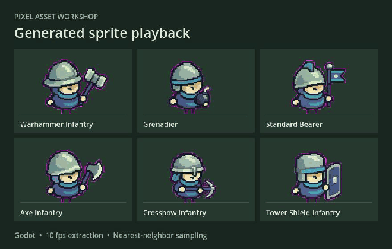

# 像素素材工坊 · Pixel Asset Workshop

[English](README.md) · [Tiny Swords 实测案例](examples/tiny-swords/README.zh.md) · [在线项目展示](https://daetz-coder.github.io/projects/pixel-asset-workshop/) · [贡献指南](CONTRIBUTING.zh.md)

从参考游戏提炼可复用的画风规则，生成自己游戏的角色和场景素材，再把多名角色的动作放进一次视频任务，拆成独立的透明 PNG 序列。适合需要扩充同一阵营、做小规模美术验证，或反复制作动作批次的独立游戏团队。



[流程宣传片](examples/tiny-swords/preview/workflow-promo.mp4) · [完整 Godot 录像](examples/tiny-swords/preview/godot-playback.mp4) · [在 Godot 对照原版与生成角色](examples/tiny-swords/README.zh.md#在-godot-中对照原版)

| 阶段 | 怎么做 | 交付 |
| --- | --- | --- |
| 1. 学习画风 | 从原图记录镜头、头身比例、像素尺度和材质色。先校准一张样图，再把规则迁移到自己的角色、建筑、地形和 UI | 画风档案、原版与新图对照、确认的样图 |
| 2. 生图与合图 | 独立生成每名角色的透明 PNG。把同规格角色按格排进同一张首帧，锁定角色顺序和脚底锚点，每格写自己的动作 | 首帧 PNG、逐格提示词、格位 JSON |
| 3. 视频与批量拆帧 | 以 Wan3.0 Video Prime 为例，每批提交一次。按成片尺寸换算格位，统一抽帧和抠像，再人工挑动作关键帧 | 每格独立的 RGBA PNG 序列、采样和贴边记录 |

实测批次包含 **6 名兵种、1 条 5 秒 Wan 成片、300 张候选透明帧**。同规格下，六个角色合成一批后，请求数由 6 次降至 1 次。实际花费取决于服务计费和返工。先用待机或步行试格，挥武器、飞行物和大范围特效需要时用更少的角色或分批。

## 快速开始：已有成片，无需密钥

需要 Python 3.10+、FFmpeg（含 ffprobe）。重新合图和本地检查 Wan 请求时还需要 ImageMagick 7（`magick`）。从项目根目录执行：

```sh
python3 -m venv .venv
. .venv/bin/activate
python -m pip install -r requirements.txt

python scripts/extract_frames.py \
  --video assets/video-inputs/blue-units-3x2-wan-prime-480p.mp4 \
  --layout examples/tiny-swords/wan-layout.json \
  --fps 10 --despill-magenta --out work/tiny-swords/frames
```

输出在 `work/tiny-swords/frames/`，例如 `r01c01/attack/0000.png`。打开 `manifest.json` 查看角色名、格位、固定画布、脚底锚点和异常帧。示例是包含待机、步行和技能的一条混合片，`attack` 只是历史布局标签；导出的 50 帧仍需按动作分别筛选。

## 用自己的角色建立一批

1. 用 [reference-game-characters](skills/reference-game-characters/SKILL.md) 建画风档案。参考 [Tiny Swords 风格对比](examples/tiny-swords/README.zh.md#原版和我们的对比)，先通过一名角色的同尺度对照，再生成同批透明 PNG。生成工具可以是有图像输入能力的 GPT Image 或其他工具。
2. 复制 [步行批次配置](examples/tiny-swords/batch-walk.json)，把路径、角色名和动作换成自己的。路径相对配置文件，角色按从左到右、从上到下放入格子。运行：

   ```sh
   python skills/wan-prime-video/scripts/compose_reference.py \
     --config examples/tiny-swords/batch-walk.json \
     --output work/tiny-swords/walk.png
   ```

   得到 `walk.png`、`walk-prompt.txt` 和 `walk-layout.json`。这套新步行输入与上面的历史混合成片分开使用。
3. 把首帧与提示词提交到视频模型。可直接使用模型界面，或按 [Wan 技能说明](skills/wan-prime-video/SKILL.zh.md) 用脚本提交和续查。导出 MP4 后，将新成片和它自己的布局交给拆帧脚本。需要可视化逐帧选择时，同一份布局也可导入 **SpriteFrame · 逐帧**。

## 项目资源

| 入口 | 适合什么 |
| --- | --- |
| [英文项目介绍](index.html) | 从本地副本打开，浏览流程、SpriteFrame 截图和 Godot 播放演示 |
| [Tiny Swords 实测案例](examples/tiny-swords/README.zh.md) | 下载实测成片和格位，在 Godot 中复现对照 |
| [风格迁移 Skill](skills/reference-game-characters/SKILL.md) | 在支持 Agent Skills 的环境复用风格档案、提示词和原帧对照工具 |
| [Wan 合图 Skill](skills/wan-prime-video/SKILL.zh.md) | 准备首帧、提示词、格位 JSON，选择性提交 Wan |
| [CLI 拆帧](scripts/extract_frames.py) | 无需模型账号，在本地稳定复现导出 |
| [集成与布局说明](docs/integrations.md) | 使用逐帧工作台、替换视频服务、对接自己的自动化工具 |

要在支持 Agent Skills 的工具中复用，把所需的整个 Skill 目录复制到该工具的技能目录；也可以直接运行这里的脚本。

## 贡献与反馈

遇到裁切或拆帧问题时，请附运行命令、格位 JSON 和受影响的帧号。 [提交问题](https://github.com/daetz-coder/pixel-asset-workshop/issues/new/choose) · [贡献指南](CONTRIBUTING.zh.md) · [离线流程测试](https://github.com/daetz-coder/pixel-asset-workshop/actions/workflows/ci.yml)

## 来源与分发

Tiny Swords 由 [Pixel Frog](https://pixelfrog-assets.itch.io/tiny-swords) 制作。请从作者处获取原包。原包、原帧裁切及包含原图的对照只用于本地；示例成片和展示图使用本项目生成的角色。代码与示例素材的发布范围见 [来源与分发说明](NOTICE.md) 和 [首次发布核对](docs/release.md)。
