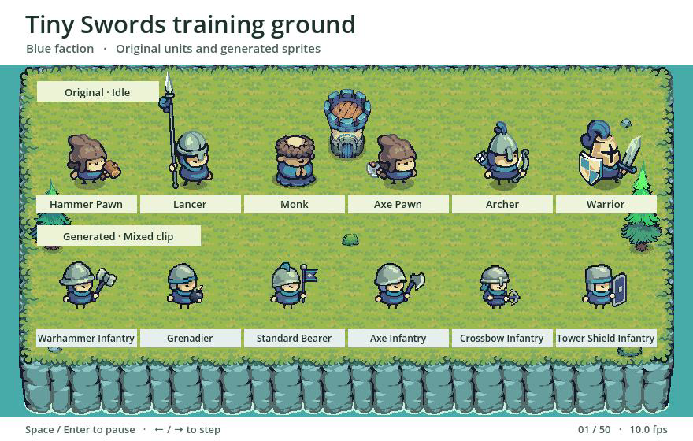
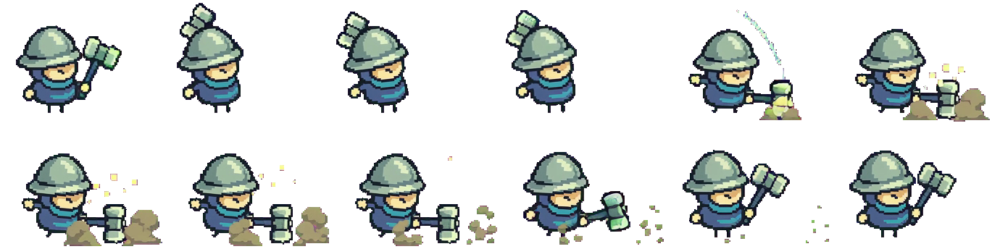
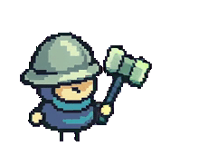
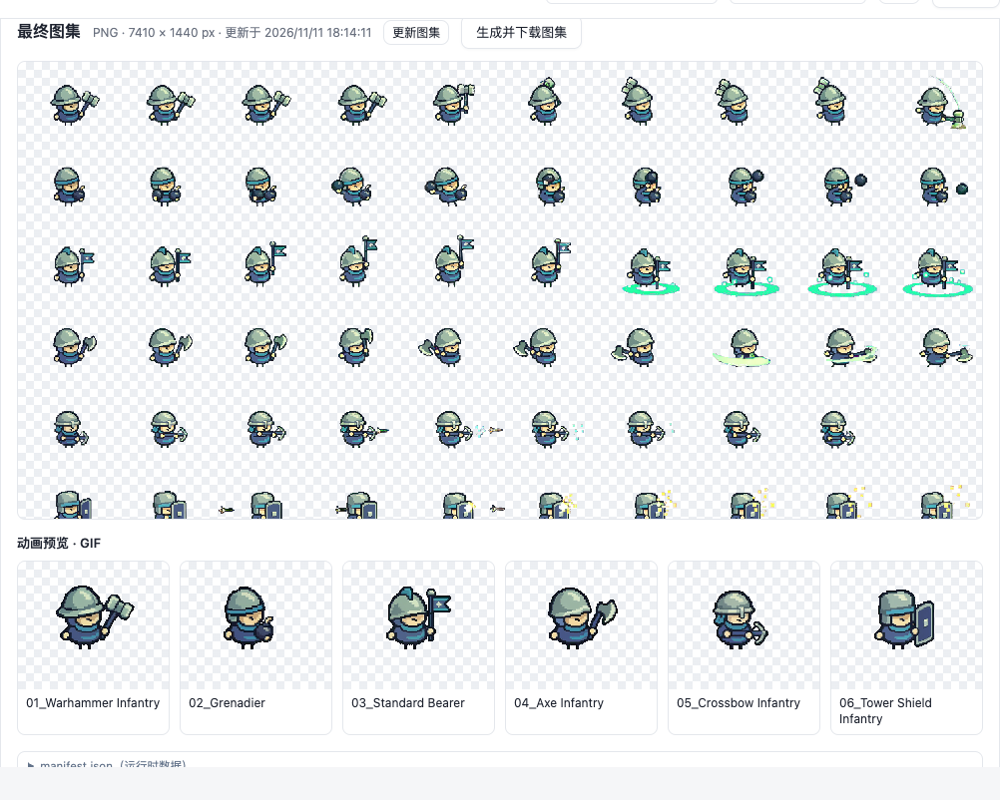

# 像素素材工坊 · Pixel Asset Workshop

[下载 SpriteFrame（ZIP）](https://github.com/daetz-coder/pixel-asset-workshop/archive/refs/heads/main.zip) · [安装 SpriteFrame](#用-spriteframe-逐帧工作台操作) · [安装命令行工具](#安装) · [English](README.md) · [Tiny Swords 实测案例](examples/tiny-swords/README.zh.md) · [在线项目展示](https://daetz-coder.github.io/projects/pixel-asset-workshop/index.zh.html) · [贡献指南](CONTRIBUTING.zh.md)

从参考游戏提炼可复用的画风规则，生成自己游戏的角色和场景素材，再把多名角色的动作放进一次视频任务，拆成独立的透明 PNG 序列。适合需要扩充同一阵营、做小规模美术验证，或反复制作动作批次的独立游戏团队。

本仓库内置 **SpriteFrame 逐帧工作台**和命令行拆帧工具。启动本地工作台即可分格、抠像、挑帧，并导出透明 PNG、精灵图和 GIF。

[](https://daetz-coder.github.io/projects/pixel-asset-workshop/showcase/godot.html)

这段 5 秒录像由 Godot 4.5.1 录制。上排播放 Tiny Swords 原版待机，下排播放自制六兵种的混合动作。原版美术由 [Pixel Frog](https://pixelfrog-assets.itch.io/tiny-swords) 制作。[在线播放实机录像](https://daetz-coder.github.io/projects/pixel-asset-workshop/showcase/godot.html) · [MP4 文件](examples/tiny-swords/preview/training-ground.mp4) · [本地运行 Godot 对照](examples/tiny-swords/README.zh.md#在-godot-中对照原版)

[观看 21.5 秒流程演示，可开启中文字幕](https://daetz-coder.github.io/projects/pixel-asset-workshop/showcase/godot.html#workflow-video)

| 阶段 | 怎么做 | 交付 |
| --- | --- | --- |
| 1. 学习画风 | 从原图记录镜头、头身比例、像素尺度和材质色。先校准一张样图，再把规则迁移到自己的角色、建筑、地形和 UI | 画风档案、原版与新图对照、确认的样图 |
| 2. 生图与合图 | 独立生成每名角色的透明 PNG。把同规格角色按格排进同一张首帧，锁定角色顺序和脚底锚点，每格写自己的动作 | 首帧 PNG、逐格提示词、格位 JSON |
| 3. 视频与批量拆帧 | 以 Wan3.0 Video Prime 为例，每批提交一次。按成片尺寸换算格位，统一抽帧和抠像，再人工挑动作关键帧 | 每格独立的 RGBA PNG 序列、采样和贴边记录 |

实测批次包含 **6 名兵种、1 条 5 秒 Wan 成片**。SpriteFrame 按源帧率保留 900 张候选帧，10 fps 命令行示例抽取 300 张。同规格下，六个角色合成一批后，请求数由 6 次降至 1 次。实际花费取决于服务计费和返工。先用待机或步行试格，挥武器、飞行物和大范围特效需要时用更少的角色或分批。

## 导出的精灵图与 GIF

战锤兵的透明精灵图和 GIF 使用同一组 12 帧。精灵图按从左到右、从上到下排列，GIF 每帧播放 200 毫秒。

[](examples/tiny-swords/preview/exports/warhammer-sheet.png)



[查看全部六套精灵图和 GIF](https://daetz-coder.github.io/projects/pixel-asset-workshop/showcase/spriteframe.zh.html#exports) · [帧坐标、脚底锚点与时长](examples/tiny-swords/preview/exports/manifest.json)

## 安装

1. 用 Git 克隆仓库，或下载 ZIP 解压。接下来的项目命令都在包含 `requirements.txt` 的目录运行。[下载项目 ZIP](https://github.com/daetz-coder/pixel-asset-workshop/archive/refs/heads/main.zip)

   ```sh
   git clone https://github.com/daetz-coder/pixel-asset-workshop.git
   cd pixel-asset-workshop
   ```

2. 安装 Python 3.10 或更新版本，以及 FFmpeg。macOS 和 Linux 用 `python3 --version` 检查版本，Windows 用 `py -3 --version`。在终端确认 `ffmpeg -version` 和 `ffprobe -version` 都能运行。[下载 Python](https://www.python.org/downloads/) · [下载 FFmpeg](https://ffmpeg.org/download.html)

   | 系统 | 安装方式 |
   | --- | --- |
   | macOS，已安装 Homebrew | 运行 `brew install ffmpeg`。若 `python3` 缺失或低于 3.10，请安装新版 Python。 |
   | Ubuntu 或 Debian | 运行 `sudo apt install python3 python3-venv ffmpeg`，然后确认 Python 版本。 |
   | Windows，已安装 WinGet | 运行 `winget install --id Gyan.FFmpeg --exact`。安装 Python 时启用启动器，安装后重新打开 PowerShell。 |

3. 按系统创建 Python 虚拟环境并安装项目依赖。

   **macOS 或 Linux**

   ```sh
   python3 -m venv .venv
   . .venv/bin/activate
   python -m pip install -r requirements.txt
   ```

   **Windows PowerShell**

   ```powershell
   py -3 -m venv .venv
   .\.venv\Scripts\python.exe -m pip install -r requirements.txt
   ```

需要重新合图或在本地检查 Wan 请求时，再安装 ImageMagick 7（`magick`）。下方拆帧示例只需上面的依赖。[下载 ImageMagick](https://imagemagick.org/script/download.php)

## 快速开始：已有成片，无需密钥

使用仓库自带的 MP4 和配套格位，运行一次本地拆帧。这个示例无需 API Key。

```sh
python scripts/extract_frames.py \
  --video assets/video-inputs/blue-units-3x2-wan-prime-480p.mp4 \
  --layout examples/tiny-swords/wan-layout.json \
  --fps 10 --despill-magenta --out work/tiny-swords/frames
```

Windows PowerShell 直接使用虚拟环境里的 Python。

```powershell
.\.venv\Scripts\python.exe scripts/extract_frames.py --video assets/video-inputs/blue-units-3x2-wan-prime-480p.mp4 --layout examples/tiny-swords/wan-layout.json --fps 10 --despill-magenta --out work/tiny-swords/frames
```

成功后终端会显示 **6 cells × 50 frames**。打开 `work/tiny-swords/frames/r01c01/attack/0000.png` 检查第一张透明帧，打开同一输出目录下的 `manifest.json` 查看格位、脚底锚点和异常帧。重跑时给 `--out` 指定一个新目录。示例是混合动作片，导入游戏前按动作筛选帧。

如需复现示例的精灵图和 GIF，运行 `python examples/tiny-swords/export_previews.py --frames work/tiny-swords/frames --out work/tiny-swords/exports`。在 PowerShell 中把 `python` 换成 `.\.venv\Scripts\python.exe`。

## 用 SpriteFrame 逐帧工作台操作

macOS 或 Linux 上先克隆仓库或解压 ZIP，准备 Python 3.11 或更新版本，以及 FFmpeg 和 ffprobe。在仓库根目录运行以下命令。[工作台使用说明](workbench/README.zh.md)

```sh
./workbench/setup.sh
./workbench/start.sh
```

打开 `http://127.0.0.1:8766`。工作台默认英文，可从右上角切换中文。点击**导入格位 JSON**，再打开同一批的 MP4。底色选**洋红**，点击**逐帧提取并挑选**。在**筛帧**里检查自动初选的序列，再保存 PNG、图集或 GIF。[示例格位](examples/tiny-swords/wan-layout.json) · [示例 MP4](assets/video-inputs/blue-units-3x2-wan-prime-480p.mp4) · [操作演示](https://daetz-coder.github.io/projects/pixel-asset-workshop/showcase/spriteframe.zh.html)

[](workbench/README.zh.md)

## 安装 Agent Skills

把 `skills/` 下需要的技能目录完整复制到客户端的技能目录。如果在 Codex 中打开本仓库，复制到仓库根目录下的 `.agents/skills/`。在对话中用 `$reference-game-characters` 分析画风、`$wan-prime-video` 准备动画批次，或用 `$spriteframe` 导出审核通过的 Godot 动作资源。[Codex 技能目录说明](https://learn.chatgpt.com/docs/build-skills#where-codex-loads-local-skills)

## 用自己的角色建立一批

1. 用 [reference-game-characters](skills/reference-game-characters/SKILL.md) 建画风档案。参考 [Tiny Swords 风格对比](examples/tiny-swords/README.zh.md#原版和我们的对比)，先通过一名角色的同尺度对照，再生成同批透明 PNG。生成工具可以是有图像输入能力的 GPT Image 或其他工具。
2. 复制 [步行批次配置](examples/tiny-swords/batch-walk.json)，把路径、角色名和动作换成自己的。路径相对配置文件，角色按从左到右、从上到下放入格子。运行：

   ```sh
   python skills/wan-prime-video/scripts/compose_reference.py \
     --config examples/tiny-swords/batch-walk.json \
     --output work/tiny-swords/walk.png
   ```

   得到 `walk.png`、`walk-prompt.txt` 和 `walk-layout.json`。这套新步行输入与上面的历史混合成片分开使用。
3. 把首帧与提示词提交到视频模型。可直接使用模型界面，或按 [Wan 技能说明](skills/wan-prime-video/SKILL.zh.md) 用脚本提交和续查。导出 MP4 后，将新成片和它自己的布局交给拆帧脚本。需要可视化逐帧选择时，同一份布局也可导入 **SpriteFrame · 逐帧**。

## 项目资源

| 入口 | 适合什么 |
| --- | --- |
| [英文项目介绍](index.html) | 从本地副本打开，浏览流程、SpriteFrame 截图和 Godot 播放演示 |
| [Tiny Swords 实测案例](examples/tiny-swords/README.zh.md) | 下载实测成片和格位，在 Godot 中复现对照 |
| [风格迁移 Skill](skills/reference-game-characters/SKILL.md) | 在支持 Agent Skills 的环境复用风格档案、提示词和原帧对照工具 |
| [Wan 合图 Skill](skills/wan-prime-video/SKILL.zh.md) | 准备首帧、提示词、格位 JSON，选择性提交 Wan |
| [CLI 拆帧](scripts/extract_frames.py) | 无需模型账号，在本地稳定复现导出 |
| [集成与布局说明](docs/integrations.md) | 使用逐帧工作台、替换视频服务、对接自己的自动化工具 |

## 贡献与反馈

遇到裁切或拆帧问题时，请附运行命令、格位 JSON 和受影响的帧号。 [提交问题](https://github.com/daetz-coder/pixel-asset-workshop/issues/new/choose) · [贡献指南](CONTRIBUTING.zh.md) · [离线流程测试](https://github.com/daetz-coder/pixel-asset-workshop/actions/workflows/ci.yml)

## 开源协议

- **代码和文档**采用 MIT 协议，可商用。复制或分发全部或主要部分时保留版权和许可声明。[MIT 协议正文](LICENSE)
- **原创游戏素材**采用 CC0 1.0，包括已导出的精灵图和 GIF。可免费商用、修改和再分发，署名自愿。[CC0 正文](LICENSE-CC0) · [授权范围与第三方条款](NOTICE.md)

## 致谢

感谢 **Pixel Frog** 创作 **Tiny Swords**。工坊参考了它的角色比例、配色与动画节奏。Godot 训练场对照使用的原包素材遵循 Pixel Frog 的条款。[Tiny Swords 作者页](https://pixelfrog-assets.itch.io/tiny-swords)
