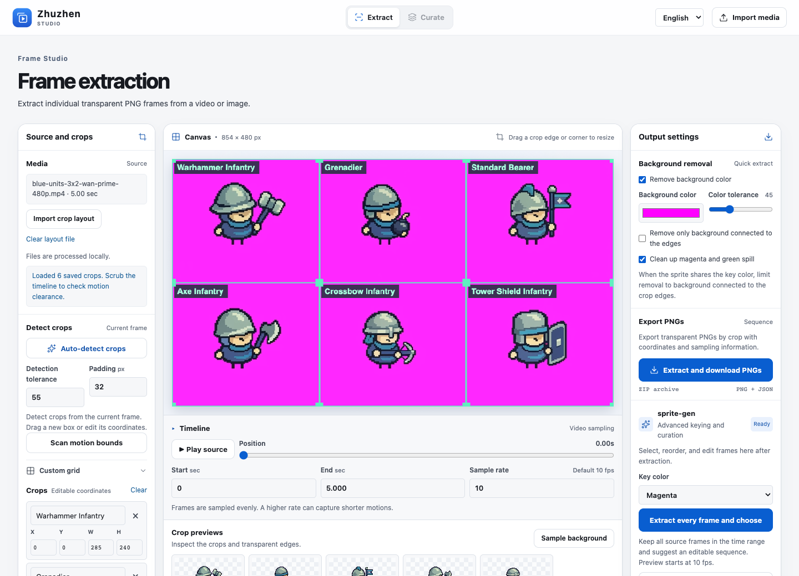
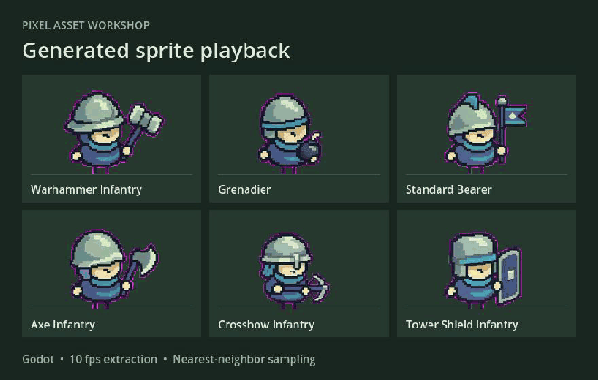
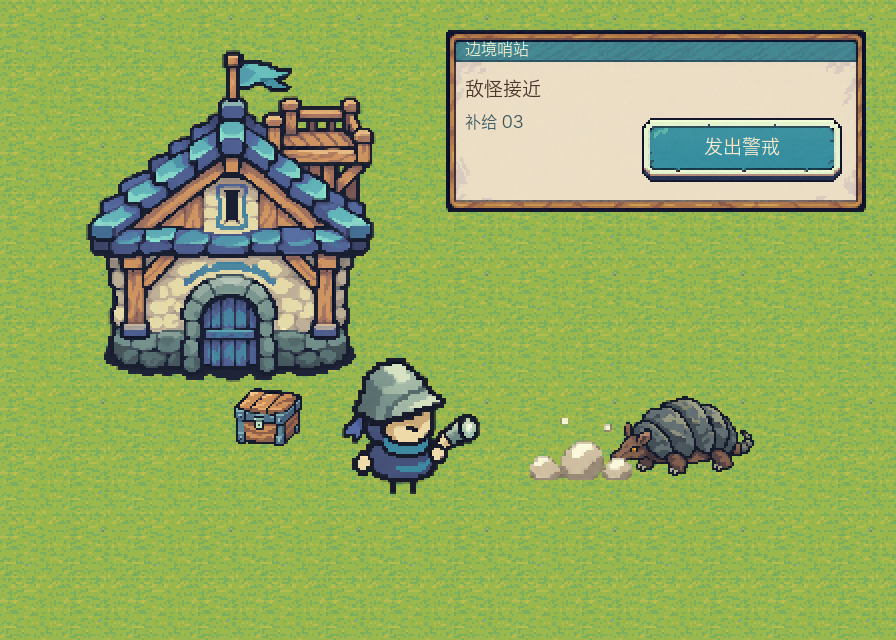

# From Tiny Swords to six original units

[Chinese](README.zh.md) · [Project home](../../README.md) · [Pixel Frog's asset pack](https://pixelfrog-assets.itch.io/tiny-swords) · [Style profile](../../skills/reference-game-characters/references/tiny-swords-art.en.md)

The Blue Archer and Lancer idle frames provided the visual baseline. The first Warhammer Infantry sample established the shared body shape and materials for the Grenadier, Standard Bearer, Axe Infantry, Crossbow Infantry and Tower Shield Infantry.

## Comparison with the original

| Aspect | Tiny Swords reference | Original units in this project |
| --- | --- | --- |
| Camera and proportions | The Blue Archer and Lancer use a slightly overhead three-quarter view, large heads and short bodies. | The first Warhammer Infantry sample carries those proportions into the five other units. |
| Hands, feet and contact | Tiny cream-gold hands have dark outlines. Short dark feet show beneath the body. The Archer has a contact shadow. | The new samples use small hands and separate thin legs. They omit the shadow to expose feet and transparent edges for inspection. |
| Materials and colors | Slate and teal cloth, sage metal, pale mint highlights and cream-gold skin. | The generated sprites carry over the material contrast and blue faction colors. The team reviewed colors and pixel clusters visually. |
| Class silhouettes | The Archer reads through a pointed helmet, bow and quiver. The Lancer reads through a spear. | The Warhammer Infantry uses a wide-brim helmet and compact two-faced hammer. Each of the other five has its own equipment silhouette. |
| Size and timing | Each Blue Archer idle frame is 192 × 192. The author specifies 10 fps. | The original concepts are 1254 × 1254 transparent PNGs. The comparison aligns visible body heights. The video export samples at 10 fps before manual selection. |

The side-by-side places the original Archer's first idle frame on the left and the first Warhammer Infantry on the right. It aligns their foot baselines and scales the annotated bodies to 67 px before enlarging both by 4× with nearest-neighbor sampling. Equipment and helmet ornaments remain visible outside the body boxes. From the repository root, run with Pillow installed.

```sh
bash scripts/compare_tiny_swords.sh '/path/to/Tiny Swords (Free Pack)'
```

Open `work/tiny-swords/comparison/archer-vs-warhammer.png`. The comparison contains Pixel Frog's art and is generated locally. Reannotate the body boxes if your pack version uses a different canvas or pose. [Blue unit reference and frame sizes](../../skills/reference-game-characters/references/tiny-swords.en.md)

## Six characters from one generated video

| Top row, left to right | Bottom row, left to right |
| --- | --- |
| Warhammer Infantry · Grenadier · Standard Bearer | Axe Infantry · Crossbow Infantry · Tower Shield Infantry |
| Downward hammer strike · Overhand toss · Raise and unfurl flag | Axe sweep · Fire bolt · Raise shield and block |



The screenshots show the actual English workbench during [extraction](preview/blue-squad.png) and [frame curation](preview/spriteframe-curate.png).

- **Input.** A 1280 × 720 first frame with three columns, two rows and a magenta key (`#FF00FF`). The submitted prompt sequences idle, walking and a skill. [First frame](../../assets/video-inputs/blue-units-3x2-reference.png) · [Exact submitted prompt](../../assets/video-inputs/blue-units-3x2-wan-prime-prompt.txt)
- **Video.** The generated Wan MP4 is 854 × 480 at 30 fps and lasts five seconds. [Actual Wan MP4](../../assets/video-inputs/blue-units-3x2-wan-prime-480p.mp4) · [Matching layout](wan-layout.json)
- **Output.** The CLI reproduced six sequences of 50 transparent PNGs each. The columns are 285, 284 and 285 px wide, and both rows are 240 px tall. All six sequences had zero empty frames. The CLI flagged Tower Shield frame `0041.png` touching the right boundary. SpriteFrame's historical export flagged index 37 touching the left boundary. The two implementations use different keying and sampling, so review both moments. [CLI command](../../README.md#reproduce-the-example-offline) · [SpriteFrame export record](spriteframe-export.json)
- **Motion review.** The clip contains the hammer strike, bomb release, flag raise and shield sparks. Check the actual timing in the clip. A fixed cell can clip weapons that cross into another cell. Isolate projectiles manually and review equipment continuity, contact poses, keying edges and loop joins.

At the same settings with no retries, separate five-second clips would take six submissions and 30 generated seconds. The batch takes one submission and five generated seconds. Image generation, rework and provider pricing affect the total cost.

Use the walk config to reproduce composition. The prompts for separate idle, walk, skill and standalone effects batches are production inputs for new clips. [Walk batch config](batch-walk.json) · [Five-second prompt set](../../assets/video-inputs/blue-units-3x2-prompt.en.md)

## Compare the original in Godot



This capture shows six generated sequences playing in Godot. [MP4 capture](preview/godot-playback.mp4) · [Godot project](godot/project.godot)

For the side-by-side review, extract the PNGs to `work/tiny-swords/frames` using the project quick start. Then run from the repository root with Godot 4.5 and your own Tiny Swords Free Pack. The scene plays the original Blue Archer idle on the left and the mixed Warhammer Infantry clip on the right. Both use nearest-neighbor sampling and a shared foot line. The Archer is enlarged 2× to bring the visible body sizes closer. Press Space or Enter to pause. [Extraction command](../../README.md#reproduce-the-example-offline)

```sh
godot --path examples/tiny-swords/godot -- --pack="/absolute/path/to/Tiny Swords (Free Pack)"
```

Record the comparison locally with Godot Movie Maker by adding `--write-movie "$PWD/work/tiny-swords/comparison.avi" --fixed-fps 10 --quit-after 50` before the `--` separator. The recording with Pixel Frog artwork belongs in the ignored `work/` directory. Compare the outline, feet, palette and pixel density. The Warhammer clip includes several actions and has some magenta spill on the edges.

## Extending the style across asset types

The frontier outpost applies the same camera, colors and pixel treatment to a lookout, stoneback armadillo, outpost, supply crate, grass, panel, button and ground-impact effect. Check the building entrance against unit height, tile seams, both button states, and the contact point and timing of the standalone effect. The asset manifest records each item's source and review status. [Frontier outpost asset manifest](../../assets/art-runs/frontier-outpost/manifest.json)


