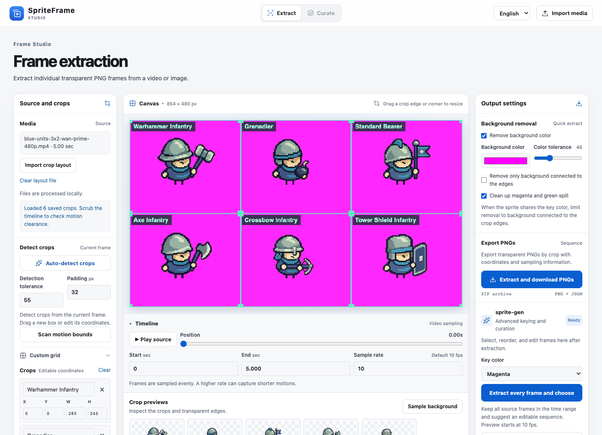
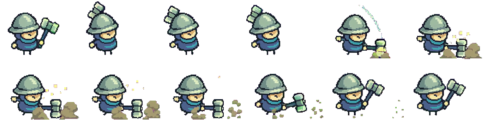
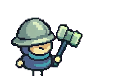
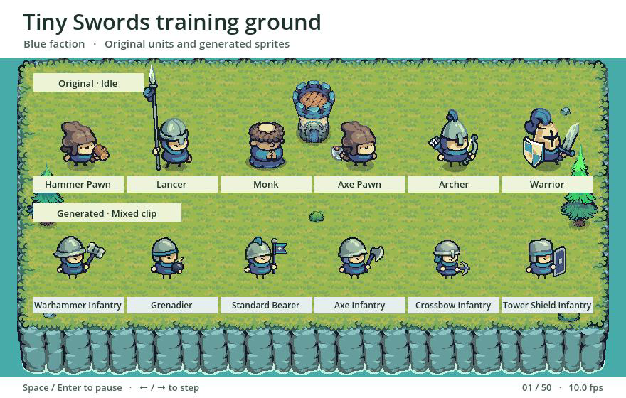

# Tiny Swords：从原版画风到原创六兵种

[English](README.md) · [返回项目](../../README.zh.md) · [Pixel Frog 作者页](https://pixelfrog-assets.itch.io/tiny-swords) · [整套画风档案](../../skills/reference-game-characters/references/tiny-swords-art.md)

本例把原包的蓝队人形当作画风参照。先看蓝队弓手与枪兵的原始待机帧，校准一张原创战锤兵，再沿用该基准做投弹兵、旗手、战斧兵、弩兵和塔盾兵。

## 原版和我们的对比

| 对照项 | Tiny Swords 原版 | 本项目原创与取舍 |
| --- | --- | --- |
| 镜头与头身 | 蓝队弓手和枪兵采用轻俯视的四分之三角度，头大身短 | 保留镜头和头身节奏；第一版战锤兵是后续五个角色的生图基准 |
| 手脚与接地 | 小米金手有深色轮廓，短深色腿脚露出；弓手有接地投影 | 延续小手和分开的细腿，样图省去投影，便于检查脚底和透明边 |
| 材质与配色 | 灰蓝、青蓝布料配绿灰金属、浅薄荷高光和米金肤色 | 沿用材质的明暗关系和蓝队识别色；生图色值与像素簇由目视校准 |
| 职业轮廓 | 弓手靠尖盔、弓和背部箭袋辨认；枪兵靠长枪辨认 | 战锤兵改用宽檐盔和短柄双面锤，其他五名各用独立装备轮廓区分 |
| 原生尺寸与动作 | 蓝队弓手待机单帧画布为 192×192，作者标注 10 fps | 原创概念图为 1254×1254 透明 PNG，文件尺寸与逻辑像素不同；比较时按主体高度对齐，成片按 10 fps 抽样后再挑关键帧 |

同尺度并排预览：左侧取原版弓手第 0 帧，右侧取第一版战锤兵；按目测框将主体统一到 67 px、对齐脚底线，再最近邻放大 4 倍。武器与盔顶羽饰不用于计算主体高度，仍会完整显示。使用项目根目录已安装 Pillow 的 Python 环境：

```sh
# 下载并解压 Free Pack，参数指向包含 Units/ 的目录。
bash scripts/compare_tiny_swords.sh '/path/to/Tiny Swords (Free Pack)'
```

打开本地的 `work/tiny-swords/comparison/archer-vs-warhammer.png`。原帧与对照图包含作者素材，因此示例只分发复现脚本。若下载版本的画布或姿势不同，请按 [蓝队角色示例](../../skills/reference-game-characters/references/tiny-swords.md) 重标身体框。

## 实测：一条视频拆六个角色

| 第一行（左 → 右） | 第二行（左 → 右） |
| --- | --- |
| 战锤兵 · 投弹兵 · 旗手 | 战斧兵 · 弩兵 · 塔盾兵 |
| 举锤下砸 · 过肩抛弹 · 举旗展开 | 横扫 · 发射弩矢 · 举盾格挡 |



[英文筛帧工作台实拍](preview/spriteframe-curate.png)

- **输入**：[实际首帧](../../assets/video-inputs/blue-units-3x2-reference.png)，1280×720、3 列 2 行、洋红底 `#FF00FF`；[实际提交提示词](../../assets/video-inputs/blue-units-3x2-wan-prime-prompt.txt) 依次要求待机、原地步行和技能。
- **成片**：[实际 Wan MP4](../../assets/video-inputs/blue-units-3x2-wan-prime-480p.mp4)，854×480、30 fps、5 秒；配套使用 [这条成片的格位](wan-layout.json)。
- **结果**：[SpriteFrame 工作台导出记录](spriteframe-export.json)。使用[本项目命令行](../../README.zh.md#快速开始已有成片无需密钥)也复现了 6×50 张透明 PNG。列宽按视频为 285 / 284 / 285 px，高度为 240 px；六组都没有空帧。CLI 标记塔盾兵 `0041.png` 触及右边界，工作台历史记录标记的是帧索引 37 触及左边界。两套实现的抠像和取样判定有差异，建议把两个片段都加入人工检查。
- **动作审查**：可在成片中看到战锤下砸、圆弹脱手、旗面抬升和盾面火星。提示词的时间段是生成目标，动作出现时间以成片为准。固定格位不会修复跨格的武器，也不会自动将弹道与角色分层。成片需要逐组确认装备连续性、接触姿势、去色边缘和循环点。

六名角色若逐个生成 5 秒视频，理论上需 6 次提交、共 30 秒成片；本例一批为 1 次、5 秒。这个对比只计算相同规格、无重试的视频用量，未计独立生图、返工和各平台定价。

[步行批次配置](batch-walk.json) 用于复现合图；[待机、步行、技能、独立特效的提示词](../../assets/video-inputs/blue-units-3x2-prompt.md) 是拆分制作方案。两者都独立于这条实测混合片。

## 导出精灵图和 GIF





每个示例从已去色边的 10 fps 序列中选取动作附近的 12 帧，每隔一帧取一张。同一兵种使用统一裁切范围并保留脚底锚点。PNG 保留原透明度，GIF 使用二值透明。[全部六套导出](https://daetz-coder.github.io/projects/pixel-asset-workshop/showcase/spriteframe.html#exports) · [帧坐标与时长清单](preview/exports/manifest.json)

```sh
python examples/tiny-swords/export_previews.py --frames work/tiny-swords/frames --out work/tiny-swords/exports
```

## 在 Godot 中对照原版

[](https://daetz-coder.github.io/projects/pixel-asset-workshop/showcase/godot.html)

这段录像由 Godot 以 10 fps 直接录制。场地、摆件和上排 Tiny Swords 角色由 [Pixel Frog](https://pixelfrog-assets.itch.io/tiny-swords) 制作。[在线播放](https://daetz-coder.github.io/projects/pixel-asset-workshop/showcase/godot.html) · [训练场 MP4](preview/training-ground.mp4)

先按快速开始将透明帧导出到 `work/tiny-swords/frames`，再从仓库根目录运行 Godot 4.5。训练场使用 Tiny Swords 原包的草地、岩壁和场景物件。上排是蓝队六个原版兵种的待机，下排是六个自制兵种的混合动作。每列对齐横向锚点，每排共用一条脚底线。原版以 1 倍显示，视频拆帧以 0.5 倍显示，让两排主体尺寸接近。两排均使用最近邻采样。空格或回车切换播放和暂停，左右方向键逐帧查看。[拆帧命令](../../README.zh.md#快速开始已有成片无需密钥)

```sh
godot --path examples/tiny-swords/godot res://comparison.tscn -- --pack="/absolute/path/to/Tiny Swords (Free Pack)"
```

原包已放在 `assets/references/tiny-swords/Tiny Swords (Free Pack)` 时可省略 `--pack`。需要录制时，在 `--` 前添加 `--write-movie "$PWD/work/tiny-swords/comparison.avi" --fixed-fps 10 --quit-after 50`。[生成角色播放录像](preview/godot-playback.mp4) · [流程宣传片](preview/workflow-promo.mp4)

21.5 秒流程演示串起成片导入、抠像、挑帧、导出和实机对照。安装 Python 与 Pillow、FFmpeg、Node.js 和 npm 后，从仓库根目录运行 `bash examples/tiny-swords/promo/render.sh` 可重建视频和封面。[观看演示，可开启中文字幕](https://daetz-coder.github.io/projects/pixel-asset-workshop/showcase/godot.html#workflow-video)
