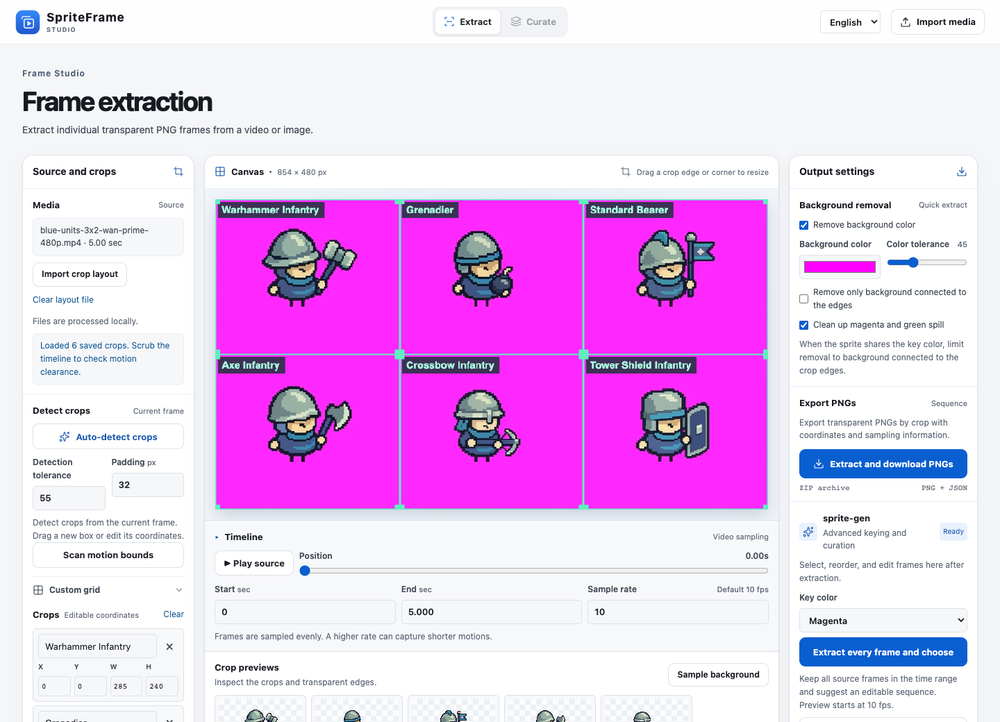
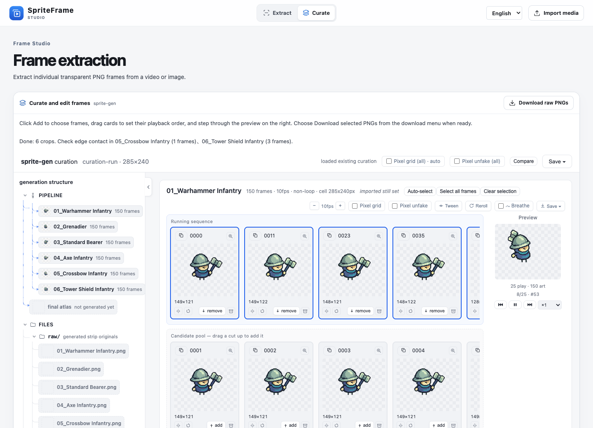
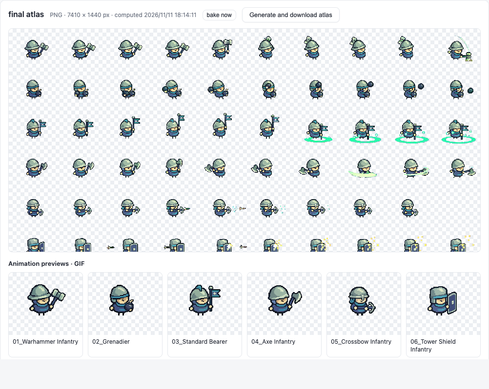

# SpriteFrame workbench

[简体中文](README.zh.md) · [Pixel Asset Workshop](../README.md)

SpriteFrame is the local browser tool bundled with Pixel Asset Workshop. It restores crop boxes from a batch layout, removes the key color, lets you select and reorder frames, and exports transparent PNGs, sprite sheets and GIFs.

## Install and start

On macOS or Linux, install Python 3.11 or newer, FFmpeg and ffprobe. Run these commands from the Pixel Asset Workshop repository root.

```sh
./workbench/setup.sh
./workbench/start.sh
```

Open [the workbench](http://127.0.0.1:8766/). English is the default. Use the language menu to switch to 中文. Setup downloads Python dependencies once, and local extraction works offline afterward. Run `./workbench/start.sh` each time you want to reopen the workbench. Use Ctrl+C in the terminal to stop it.

## Try the six-unit clip

1. Choose **Import crop layout** and select `examples/tiny-swords/wan-layout.json`. Then import the matching `assets/video-inputs/blue-units-3x2-wan-prime-480p.mp4`. [Layout](../examples/tiny-swords/wan-layout.json) · [MP4](../assets/video-inputs/blue-units-3x2-wan-prime-480p.mp4)
2. Check the six crops and choose **Magenta** as the key color. Use **Extract with sprite-gen** for sampled frames, or **Extract every frame and choose** to keep every decoded frame in the selected time range.
3. Open **Curate**. Review the suggested sequence, add or remove frames, drag them into playback order and preview each action. Use the save controls to download selected PNGs, a sprite sheet with frame coordinates, or a GIF.







[Full walkthrough and sample exports](https://daetz-coder.github.io/projects/pixel-asset-workshop/showcase/spriteframe.html)

## Command line and Godot

The [batch extractor](../README.md#reproduce-the-example-offline) writes PNG sequences directly and supports Windows. For a reviewed single-action Godot export, use the [SpriteFrame skill and CLI](../skills/spriteframe/SKILL.md) with the workbench's Python environment.

```sh
workbench/.venv/bin/python skills/spriteframe/scripts/spriteframe.py --help
```

The workbench listens on `127.0.0.1`. Download curated results before stopping it. Local media processing requires no API key. Submitting a new Wan video is optional and requires your own Model Studio credentials.

## Source and licenses

The workbench was integrated from daetz's SpriteFrame workspace at commit `0ccb55fea5fad119dede8dad9705aa2b3b312b6c` with its newer local frame selection and export changes. The bundled sprite-gen engine includes its upstream license and notices. [License scope](../NOTICE.en.md) · [sprite-gen notice](vendor/sprite-gen/NOTICE)
