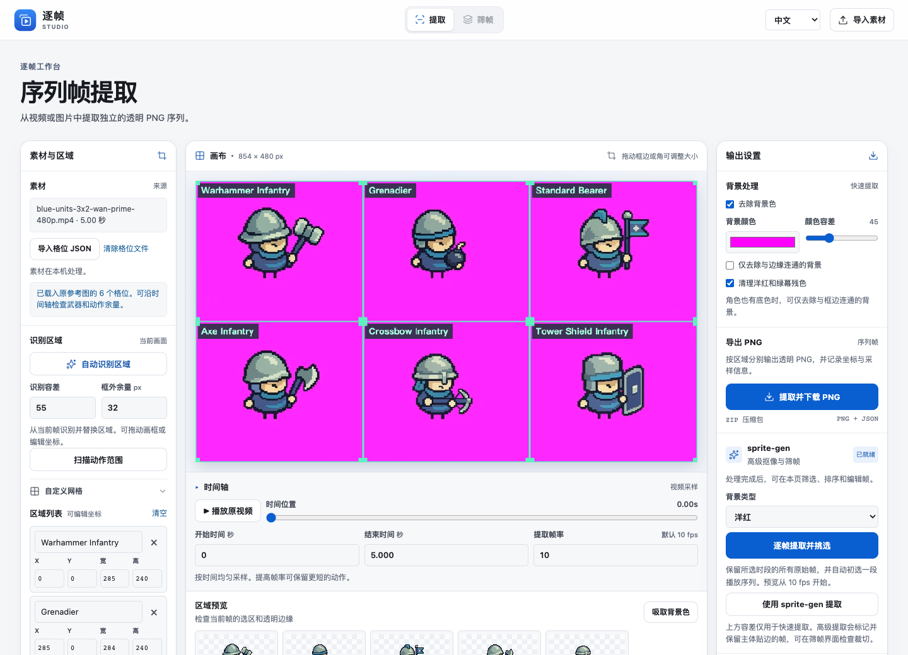
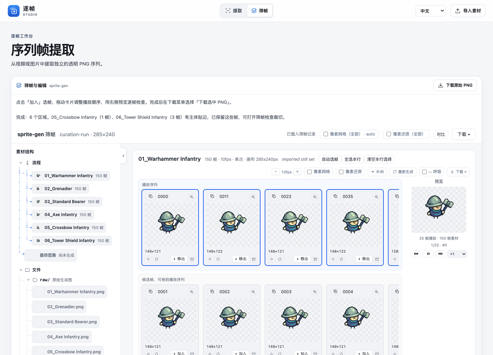
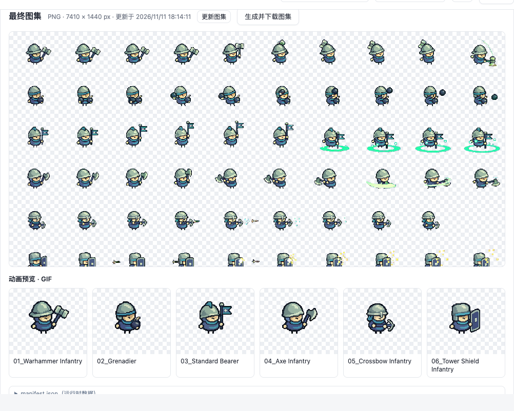

# SpriteFrame 逐帧工作台

[English](README.md) · [像素素材工坊](../README.zh.md)

SpriteFrame 随像素素材工坊提供，在本地浏览器运行。它可以按格位恢复角色裁框、去除底色、挑选和排序动作帧，并导出透明 PNG、精灵图与 GIF。

## 安装与启动

在 macOS 或 Linux 上安装 Python 3.11 或更新版本、FFmpeg 和 ffprobe。然后在像素素材工坊仓库根目录执行：

```sh
./workbench/setup.sh
./workbench/start.sh
```

打开[本地工作台](http://127.0.0.1:8766/)。默认界面为英文，可在右上角语言菜单切换为中文。首次安装需要联网下载 Python 依赖，之后可离线拆帧。再次打开时运行 `./workbench/start.sh`，使用完毕可在终端按 Ctrl+C 停止服务。

## 试跑六兵种示例

1. 点击**导入格位 JSON**，选择 `examples/tiny-swords/wan-layout.json`。再导入配套的 `assets/video-inputs/blue-units-3x2-wan-prime-480p.mp4`。[示例格位](../examples/tiny-swords/wan-layout.json) · [示例 MP4](../assets/video-inputs/blue-units-3x2-wan-prime-480p.mp4)
2. 检查六个裁框，底色选**洋红**。点击**使用 sprite-gen 提取**可按指定帧率抽样，点击**逐帧提取并挑选**可保留选定时段的每一张解码帧。
3. 进入**筛帧**。检查自动初选的序列，增减帧、拖动排序，并预览动作。使用保存菜单下载选中的 PNG、附帧坐标的精灵图或 GIF。







[中文演示与导出样例](https://daetz-coder.github.io/projects/pixel-asset-workshop/showcase/spriteframe.zh.html)

## 命令行与 Godot

[批量拆帧命令](../README.zh.md#快速开始已有成片无需密钥)可直接导出透明 PNG，也支持 Windows。需要把审核通过的单个动作导出为 Godot 资源时，可用工作台的 Python 环境运行 [SpriteFrame 技能与命令行](../skills/spriteframe/SKILL.md)。

```sh
workbench/.venv/bin/python skills/spriteframe/scripts/spriteframe.py --help
```

工作台仅监听本机的 `127.0.0.1`。停止服务前请先下载选帧结果。本地拆帧无需 API Key，提交新的 Wan 视频才需要配置 Model Studio 凭据。

## 来源与授权

工作台整合自 daetz 的 SpriteFrame 工作区，基于提交 `0ccb55fea5fad119dede8dad9705aa2b3b312b6c` 并纳入了本地更新的挑帧和导出功能。随附的 sprite-gen 引擎保留上游许可与声明。[授权范围](../NOTICE.md) · [sprite-gen 声明](vendor/sprite-gen/NOTICE)
